<a href="https://www.linkedin.com/in/daiwik-marrott">
  
</a>

<p align="center">
  <a href="mailto:daiwikmarrott4@gmail.com"></a>
  <a href="https://www.linkedin.com/in/daiwik-marrott"></a>
  <a href="https://thriving-salamander-9e9472.netlify.app"></a>
</p>

> [!IMPORTANT]
> **🟢 Pit lane open: I'm looking for Software Engineering Internships for Spring 2027.**
> Full-stack, applied AI / LLM tooling, or backend reliability. Let's talk: **daiwikmarrott4@gmail.com**



## 🏎️ Driver briefing

```yaml
driver:      Daiwik Marrott  #09
team:        Simon Fraser University · B.Sc. Computing Science, Minor in Business (grad Apr 2028)
current:     Research Assistant · CRA UR2PhD @ SFU, 120–240 fps facial-landmark tracking for biomechanics
last_stint:  Junior Software Developer (Co-op) · Coriolis Technologies, Django + LangGraph AI pipelines
strengths:   [full-stack TypeScript, Python backends, LLM evaluation, caching & rate limiting, testing]
off_track:   [Formula 1 telemetry nerd, weight room regular 🏋️, builder of software for gym staff]
seeking:     Software Engineering Internship · Spring 2027 🟢
```


## 🏆 Race history

| Pos | Team | Seat | Season | Fastest lap |
|:---:|------|------|--------|-------------|
| 🟣 **P1** | **CRA UR2PhD · Simon Fraser University** | Research Assistant | Sept 2026 – now | Extended a MediaPipe pipeline to 120–240 fps video to catch **65 ms** articulatory transitions that 30 fps webcams miss, with a **0.5 mm** residual gate |
| 🟢 **P2** | **Coriolis Technologies** | Junior Software Developer (Co-op) | May – Dec 2025 | Built a **LangGraph** pipeline (Gemini + OpenAI) that generates, verifies and synthesizes intern guidance. Cached **5 AI workflows** and shipped multi-tenant Django 5.2 features |
| 🟡 **P3** | **Fraser International College** | IT Squad Leader | Sept – Dec 2022 | Fixed device, network and OS issues for students, faculty and staff, and ran software workshops for non-technical users |

## 🏁 Grand Prix calendar · selected projects

| Round | Grand Prix | Stack | Highlights |
|:-----:|------------|-------|-------------|
| **R1** | [**TracePilot**](https://github.com/DaiwikMarrott/TracePilot) | React · TypeScript · Express · SQLite · Claude API | Side-by-side evaluation console for versioned Claude prompts. SSE streaming with cancellation, timeouts and bounded retries; fixture-based scoring of latency and token usage; Vitest + MSW chaos tests |
| **R2** | [**F1 Heads-Up Display**](https://github.com/DaiwikMarrott/F1-Display) 🏎️ | React · TypeScript · Vite · OpenF1 API | Live telemetry and deterministic race replay across **19 components / 7 hooks**. Per-endpoint caching, request deduplication and shared HTTP 429 cooldowns; **27** test suites |
| **R3** | [**Marrotts Travel Express**](https://github.com/DaiwikMarrott/Marrotts-Travel-Express-) | React · Node · Express · Firebase · Tailwind | **55+** components for group trip planning. Gemini behind an Express proxy with a model allow-list, per-IP rate limits and a 256 KB request cap |
| **R4** | [**Grid Anomaly Detector**](https://github.com/Priyanshsarvaiya/Analyzing-Electricity-Grids-using-Markov-Models) | Python · R · Markov chains · pandas | Models cyberattack patterns in power-grid data to flag anomalies |

## 🏋️ Off track: the weight room


When I'm not at a keyboard, I'm under a barbell. I'm a recipient of the **SFU Recreation Leadership Scholarship**, and I've written software for the people who run the gym:

- **FitForge** <sub>(private)</sub>: an anonymous communication platform for gym staff with role-based access for coordinators, senior recreation leaders, weight room supervisors and recreation leaders. React (Expo) · TypeScript · Firebase.
- **Weightroom Supervisor Task Manager** <sub>(private)</sub>: a desktop logbook that replaces paper task sheets for weight room supervisors. Staff initial off equipment checks and maintenance tasks. C# · WPF (MVVM) · EF Core · SQLite.


## 🔧 Car setup

<p>
  <br/>
  <br/>
  
</p>

<p>
  
  
  
  
  
  
  
  
  
</p>

**Pit-wall specialties:** caching · code splitting · rate limiting · request deduplication · exponential backoff · stream cancellation · latency and token observability

## 📡 Telemetry


### 🗓️ Season calendar



### 🛞 Activity graph

<picture>
  <source media="(prefers-color-scheme: dark)" srcset="https://raw.githubusercontent.com/DaiwikMarrott/DaiwikMarrott/output/f1-track-dark.svg" />
  <source media="(prefers-color-scheme: light)" srcset="https://raw.githubusercontent.com/DaiwikMarrott/DaiwikMarrott/output/f1-track.svg" />
  
</picture>

### 🔁 Latest pit stops
<!-- PITSTOPS:START -->
- 🔧 [**Room_tracker**](https://github.com/DaiwikMarrott/Room_tracker) <sub>· Oct 31, 2026</sub>
- 🔧 [**TracePilot**](https://github.com/DaiwikMarrott/TracePilot) <sub>· Oct 25, 2026</sub>
- 🔧 [**CMPT372---ass3-**](https://github.com/DaiwikMarrott/CMPT372---ass3-) <sub>· Aug 9, 2026</sub>
- 🔧 [**SecureThings_272_GP**](https://github.com/DaiwikMarrott/SecureThings_272_GP) — Group Project for CMPT272 <sub>· Dec 3, 2024</sub>
- 🔧 [**Database_Assignment2**](https://github.com/DaiwikMarrott/Database_Assignment2) <sub>· Feb 25, 2024</sub>
<!-- PITSTOPS:END -->


<sub>Telemetry, calendar, weight-room PRs and pit stops refresh daily via GitHub Actions. All animations are self-hosted CSS-in-SVG (transform/opacity only, no GIFs or JS) and respect <code>prefers-reduced-motion</code>.</sub>
