<a href="https://www.linkedin.com/in/daiwik-marrott">
  
</a>

<p align="center">
  <a href="mailto:daiwikmarrott4@gmail.com"></a>
  <a href="https://www.linkedin.com/in/daiwik-marrott"></a>
  <a href="https://daiwikmarrott.com"></a>
</p>

> [!IMPORTANT]
> **🟢 Pit lane open: I'm looking for Software Engineering Internships for Spring 2027.**
> Full-stack, applied AI / LLM tooling, or backend reliability. Let's talk: **daiwikmarrott4@gmail.com**


## 🏎️ Driver briefing

```yaml
driver:      Daiwik Marrott  #09
team:        Simon Fraser University · B.Sc. Computing Science, Minor in Business (grad Aug 2027)
current:     Research Assistant · CRA UR2PhD @ SFU, 120–240 fps facial-landmark tracking for biomechanics
last_stint:  Junior Software Developer (Co-op) · Coriolis Technologies, Django + LangGraph AI pipelines
also:        Weight Room Supervisor @ SFU Recreation · Senior Customer Service Specialist @ Fresh St. Market
strengths:   [full-stack TypeScript, Python backends, LLM evaluation, caching & rate limiting, testing]
people:      [first-line tech support, 150+ members served, trained & mentored new staff and volunteers]
off_track:   [Formula 1 telemetry nerd, weight room regular 🏋️, builder of software for gym staff]
paddock:     daiwikmarrott.com
seeking:     Software Engineering Internship · Spring 2027 🟢
```


## 🏆 Race history

| Pos | Team | Seat | Season | Fastest lap |
|:---:|------|------|--------|-------------|
| 🟣 **P1** | **CRA UR2PhD · Simon Fraser University** | Research Assistant | Sept 2026 – now | Extended a MediaPipe pipeline to 120–240 fps video to catch **65 ms** articulatory transitions that 30 fps webcams miss, mapping **17 landmarks** onto a biomechanical face model with a **0.5 mm** residual gate |
| 🟢 **P2** | **UpSmart Solutions** | Cyber Security Associate (Co-op) | Sept – Dec 2025 | SOC analyst training on the Managed Security Services team. Built a Kali/Windows lab with a **Wazuh SIEM**, analyzed captures in Wireshark, and wrote firewall-log-to-SIEM use cases |
| 🟢 **P3** | **Coriolis Technologies** | Junior Software Developer (Co-op) | May – Dec 2025 | Built a **LangGraph** pipeline (Gemini + OpenAI) that generates, verifies and synthesizes intern guidance. Cached **5 AI workflows** and shipped multi-tenant Django 5.2 features |
| 🟡 **P4** | **Fraser International College** | IT Squad Leader | Sept 2023 – Apr 2024 | First point of contact for **100+** students and staff across Windows, macOS, iOS and Android. Built a Google Forms + Excel-macro ticketing workflow and ran cybersecurity workshops |
| 🟡 **P5** | **Fresh St. Market · Vancouver House** | Senior Customer Service Specialist | Sept 2023 – now | **200+** daily POS transactions with accurate cash handling. Diagnoses register glitches and trained new cashiers on POS troubleshooting over **1.5 years** |
| 🟡 **P6** | **SFU Recreation Services** | Weight Room Supervisor | May 2023 – now | First point of contact for **150+** members. Runs safety checks, troubleshoots Fusion software, mentored **5** volunteers and builds weekly Excel membership reports |
| ⚪ **P7** | **Fraser International College** | Senior Orientation Leader | Apr – Sept 2023 | Welcomed **1,200+** international students, triaged and escalated student concerns, and interviewed Orientation Leader candidates |
| ⚪ **P8** | **Fraser International College** | Orientation Leader | Sept 2022 – Apr 2023 | Led sessions for **150+** new students each term and launched a peer-mentorship initiative |

## 🏁 Grand Prix calendar · selected projects

| Round | Grand Prix | Stack | Highlights |
|:-----:|------------|-------|-------------|
| **R1** | [**TracePilot**](https://github.com/DaiwikMarrott/TracePilot) | React · TypeScript · Express · SQLite · Claude API | Side-by-side evaluation console for versioned Claude prompts. SSE streaming with cancellation, timeouts and bounded retries; fixture-based scoring of latency and token usage; Vitest + MSW chaos tests |
| **R2** | [**F1 Heads-Up Display**](https://github.com/DaiwikMarrott/F1-Display) 🏎️ | React · TypeScript · Vite · OpenF1 API | Live telemetry and deterministic race replay across **19 components / 7 hooks**. Per-endpoint caching, request deduplication and shared HTTP 429 cooldowns; **27** test suites |
| **R3** | [**Courtyard Pulse**](https://github.com/DaiwikMarrott/Room_tracker) | React Native · Expo · TypeScript · SQLite | Offline-first app tracking visits for **41** residence rooms, with priorities, bulk updates and CSV export through the native share sheet; **10** Vitest tests |
| **R4** | [**Self-Updating GitHub Profile**](https://github.com/DaiwikMarrott/DaiwikMarrott) | Node.js · GitHub GraphQL API · GitHub Actions | This page. A Node script turns GraphQL contribution data into animated SVGs, regenerated daily by two scheduled workflows |
| **R5** | **ResQPlate** <sub>(team repo)</sub> | TypeScript · React · Express · Drizzle · PostgreSQL | Food-rescue platform (CMPT 372). Built the seeker browse/reserve flow and grew the backend suite from **~84 to ~200** tests |
| **R6** | **Marrotts Travel Express** <sub>(private)</sub> | React · Node · Express · Firebase · Tailwind | **55+** components for group trip planning. Gemini behind an Express proxy with a model allow-list, per-IP rate limits and a 256 KB request cap |
| **R7** | [**HTTPS Reverse-Proxy Deployment**](https://github.com/DaiwikMarrott/CMPT372---ass3-) | Nginx · Google Cloud · Express · pm2 | Nginx TLS front end on a GCP Ubuntu VM reverse-proxying an Express app, with HTTP→HTTPS redirects and a Basic-Auth private route |
| **R8** | [**Grid Anomaly Detector**](https://github.com/Priyanshsarvaiya/Analyzing-Electricity-Grids-using-Markov-Models) | Python · R · Markov chains · pandas | Models cyberattack patterns in power-grid data to flag anomalies |
| **R9** | [**SecureThings 9-1-1 Reporting**](https://github.com/DaiwikMarrott/SecureThings_272_GP) | JavaScript · Bootstrap · Leaflet | 5-person team app. Led a **1,200+** line Bootstrap UI overhaul and built the first Leaflet map features |
| **R10** | [**Student Records Web App**](https://github.com/DaiwikMarrott/CMPT276-Assignment-2) | Java 17 · Spring Boot 3 · PostgreSQL · Docker | Full-CRUD records app with JPA and Thymeleaf, containerized with a multi-stage Docker build |

<sub>Full portfolio with screenshots at <a href="https://daiwikmarrott.com">daiwikmarrott.com</a>.</sub>

## 🏋️ Off track: the weight room



When I'm not at a keyboard, I'm under a barbell. I'm a recipient of the **SFU Recreation Leadership Scholarship**, and I've written software for the people who run the gym:

- **FitForge** <sub>(private)</sub>: an anonymous communication platform for gym staff with role-based access for coordinators, senior recreation leaders, weight room supervisors and recreation leaders. React (Expo) · TypeScript · Firebase.
- **Weightroom Supervisor Task Manager** <sub>(private)</sub>: a desktop logbook that replaces paper task sheets for weight room supervisors. Staff initial off equipment checks and maintenance tasks. C# · WPF (MVVM) · EF Core · SQLite.


## 🔧 Car setup

<p>
  <br/>
  <br/>
  <br/>
  
</p>

<p>
  
  
  
  
  
  
  
  
  
</p>

**Pit-wall specialties:** caching · code splitting · rate limiting · request deduplication · exponential backoff · stream cancellation · latency and token observability

**Crew skills:** technical support · customer service and escalations · POS and cash handling · training and mentoring · event coordination · Excel reporting

**Licences:** BCRPA Personal Training · Red Cross Standard First Aid & CPR · LinkedIn Learning Python · Cybersecurity Certificate &nbsp;|&nbsp; **Languages:** English, Hindi, Gujarati, Sindhi, French (beginner–intermediate), Spanish (beginner)

## 📡 Telemetry



### 🗓️ Season calendar


### 🛞 Activity graph

<picture>
  <source media="(prefers-color-scheme: dark)" srcset="https://raw.githubusercontent.com/DaiwikMarrott/DaiwikMarrott/output/f1-track-dark.svg" />
  <source media="(prefers-color-scheme: light)" srcset="https://raw.githubusercontent.com/DaiwikMarrott/DaiwikMarrott/output/f1-track.svg" />
  
</picture>

### 🔁 Latest pit stops
<!-- PITSTOPS:START -->
- 🔧 [**TracePilot**](https://github.com/DaiwikMarrott/TracePilot) <sub>· Nov 20, 2026</sub>
- 🔧 [**Room_tracker**](https://github.com/DaiwikMarrott/Room_tracker) <sub>· Nov 1, 2026</sub>
- 🔧 [**CMPT372---ass3-**](https://github.com/DaiwikMarrott/CMPT372---ass3-) <sub>· Aug 10, 2026</sub>
- 🔧 [**F1-Display**](https://github.com/DaiwikMarrott/F1-Display) <sub>· Jul 7, 2026</sub>
- 🔧 [**SecureThings_272_GP**](https://github.com/DaiwikMarrott/SecureThings_272_GP) — Group Project for CMPT272 <sub>· Dec 4, 2024</sub>
<!-- PITSTOPS:END -->


<sub>Telemetry, calendar, weight-room PRs and pit stops refresh daily via GitHub Actions. All animations are self-hosted CSS-in-SVG (transform/opacity only, no GIFs or JS) and respect <code>prefers-reduced-motion</code>.</sub>
